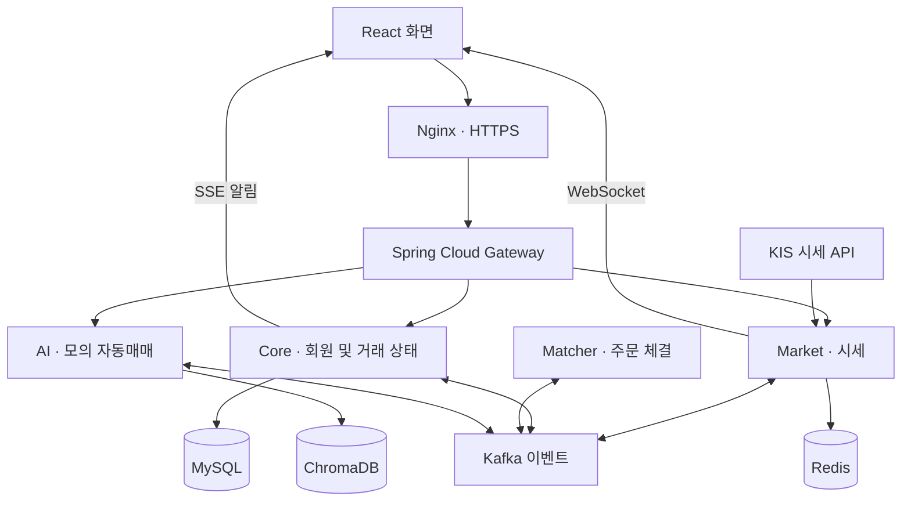
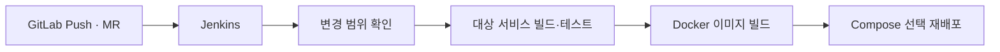

# 싸피증권 · SSAFY-Stock

프로젝트 소개용 저장소입니다. 전체 소스 코드는 공개하지 않습니다.

### 실시간 시세로 경험하는 주식 모의투자

실시간 시세와 주문·체결, 투자 커뮤니티, AI 자동매매를 제공하는 모의투자 서비스입니다. 
KIS API의 실제 시세를 활용하며, 주문은 서비스 내부의 모의 계좌에서 처리합니다.

[화면 포트폴리오](docs/screens.md) · [기술 기여와 검증 범위](docs/engineering.md) · [개발자 소개](https://github.com/sohnsw95)

 

## 프로젝트 개요

| 항목 | 내용 |
|---|---|
| 과정 | SSAFY 14기 특화 프로젝트 · 금융특화 |
| 공식 프로젝트 기간 | 2026.02.19 ~ 2026.03.30 |
| 팀 구성 | 6명 |
| 내 역할 | 팀장 · 백엔드 · 인프라 · CI/CD |
| 수상 | 특화 프로젝트 우수상 |

## 어떤 서비스를 만들었나요?

사용자가 시세를 살펴보고 직접 투자하거나, AI가 관리하는 모의 계좌의 매매를 경험할 수 있는 서비스입니다.
시세 수신, 주문·체결, 계좌 상태, AI 기능을 각각의 서비스로 나누고 메시지로 연결했습니다.

| 기능 | 설명 |
|---|---|
| 실시간 시세 | KIS API에서 받은 종목 시세·호가를 화면에 전달 |
| 모의 주문·체결 | 주문을 기록하고 매칭 결과를 계좌·포지션에 반영 |
| 자산·랭킹 | 모의 계좌의 보유 자산과 투자 성과 확인 |
| AI 자동매매 | AI가 종목과 매수·매도를 판단해 모의 주문 실행 |
| 커뮤니티 | 투자 관련 정보를 나누는 게시판 |
| 회원·관심종목 | 인증, 투자성향 및 관심종목 관리 |

사용자 직접 매매 계좌와 AI 관리 계좌를 구분했습니다.

 

## 시스템 구조

아래는 주요 서비스의 책임과 이벤트 흐름을 간추린 구조입니다.

| 영역 | 프로젝트 기술 |
|---|---|
| 화면 | React |
| 서버 | Spring Boot · Spring Cloud Gateway · Go · FastAPI |
| 메시징·실시간 통신 | Kafka · Redis · WebSocket · SSE |
| 데이터·외부 연동 | MySQL · ChromaDB · S3 · KIS Open API |
| 배포 | Docker Compose · Jenkins · GitLab Webhook · Nginx · AWS |
| 상태 점검 | Prometheus · Grafana · 서비스별 health endpoint |
| 협업 | GitLab · Jira · Notion · Mattermost |

 

## 제가 맡은 부분

**특화 프로젝트에서는 회원·인증·관심종목과 배포를, 이후 Theseus 연동에서는 커뮤니티 백엔드를 확장했습니다.**

### 특화 프로젝트 · 2026년 2–3월

| 영역 | 직접 구현·담당한 내용 |
|---|---|
| 회원·인증 | 회원가입·투자성향, 로그인·JWT 발급, 인증 경로 조정 |
| 관심종목 | 등록·조회·삭제 API, 종목·사용자 검증, 중복 등록 및 등록 개수 제한 |
| Gateway | 인증·라우팅 구성과 요청 경로 조정 |
| 설계·팀 운영 | DB/ERD·API 공통 정책 정리, 일정 관리와 연동 조율 |
| 인프라·CI/CD | Compose 4개 레이어 분리, Jenkins 변경 서비스 선별 배포, Nginx HTTPS·프록시 |
| 데이터 보존 | AI 서버 ChromaDB 볼륨·마운트 추가 |

### Theseus 연동 후속 개발 · 2026년 5월

| 영역 | 직접 구현·담당한 내용 |
|---|---|
| 커뮤니티 | 종목별 게시글·댓글 CRUD, 수정·삭제 시 작성자 권한 검사 |
| 주주 배지 | 해당 종목의 보유 수량을 기준으로 주주 여부 조회, 목록 작성자들을 묶어서 조회 |
| 좋아요·정렬 | 게시글·댓글 좋아요 토글, 좋아요 수·본인 상태 응답, 최신·좋아요·댓글·조회수 정렬 |
| 자산 요약 | 보유 종목 평가액·손익·구성 비중을 계산하는 포트폴리오 요약 API |
| DDL·SQL | 커뮤니티 테이블·외래키·조회 인덱스, 기존 스키마를 확인하는 보정 SQL |
| API 계약·검증 | `isShareholder` JSON 필드명 보정, 직렬화·작성자 권한·좋아요 단위 테스트 작성 |
| 연동·배포 | 커뮤니티 Gateway 경로, 화면 API 연동, `stock_dev` 후속 배포 조건 조정 |

체결엔진·시세 수신·AI 매매 판단은 팀의 구현입니다. 메시징 문제를 추적한 경험은 있으나,
체결 중복 수정과 시세 처리 성능 개선을 제 단독 구현으로 포함하지 않았습니다.

[변경 근거와 설계 판단 →](docs/engineering.md)

 

## 배포 구성

### 서비스 변경 범위에 맞춰 배포하기

여러 서버가 함께 동작하는 환경에서 매번 전체 스택을 재시작하는 대신,
변경된 서비스에 맞춰 빌드·배포 범위를 나누었습니다.

- Docker Compose를 `web`, `server`, `infra`, `monitoring`의 4개 레이어로 분리했습니다.
- Git diff를 이용해 변경된 서비스를 식별하고 Jenkins에서 선별 배포하도록 구성했습니다.
- Push·MR 이벤트에서 빌드·테스트를 실행하고, 특화 당시 `dev` 브랜치에서 배포하도록 구성했습니다.
- Jenkins Credentials로 환경 파일을 주입했습니다.

이 배포 흐름은 변경 서비스의 재배포 방식이며 무중단 배포를 의미하지 않습니다.

## 대표 문제 해결

### 게시판 화면에 필요한 권한·배지·응답 계약을 함께 만들기

종목별 게시판은 CRUD뿐 아니라 **누가 수정할 수 있는지, 작성자가 주주인지, 내가 좋아요를 눌렀는지**를 함께 제공해야 했습니다.

- 게시글·댓글의 수정·삭제 전에 요청자와 작성자를 비교했습니다.
- 목록의 작성자 ID를 모아 닉네임과 주주 여부를 조회하고, 결과를 응답에 결합했습니다.
- `isShareholder`가 화면의 기대와 다른 JSON 이름으로 나가지 않도록 명시적으로 지정하고 직렬화 테스트를 추가했습니다.
- 테이블 생성뿐 아니라 기존 테이블의 외래키·인덱스 유무를 확인하는 SQL을 보완했습니다.

구현과 테스트 소스는 확인되며, 당시 테스트 실행 로그나 전후 응답 시간 측정값은 별도로 확인되지 않았습니다.
따라서 조회 구조의 개선과 측정된 성능 향상을 구분합니다.

### Jenkins 하위 경로와 Nginx 프록시 경로 맞추기

**문제** 
Jenkins를 Nginx의 하위 경로로 제공하는 과정에서 crumb 403 오류가 발생했습니다.

**수정**

- Jenkins 실행 prefix를 `/jenkins`로 설정했습니다.
- Nginx의 `/jenkins/` 요청을 같은 경로로 전달하도록 맞췄습니다.
- 불필요한 cookie/path 재작성을 제거했습니다.
- `/jenkins` 요청을 `/jenkins/`로 연결하는 리다이렉트를 추가했습니다.

애플리케이션의 기준 경로와 프록시가 전달하는 경로를 함께 확인해야 한다는 점을 배웠습니다.

 

## Theseus와의 후속 연동

특화 프로젝트 종료 후, Theseus의 Remote Workspace에서 싸피증권 EC2를 연결해 후속 개발과 운영에 활용했습니다.

| 비공개 코드 브랜치 | 용도 |
|---|---|
| `main` · `dev` | 특화 프로젝트 당시 개발 이력 |
| `stock_dev` | Theseus 연동 후속 개발 이력 |
| `stock-prod` | 후속 배포 관련 이력 |

후속 작업 중에는 마켓 서버가 실행 중인데도 시세 화면이 갱신되지 않는 상황을 다뤘습니다.
수신 로그와 Redis·Kafka·WebSocket 구간을 나눠 점검하고, 마켓 서버 재시작 후 시세 수신과 화면 갱신을 확인했습니다.
이 사례는 특화 기간의 성과와 구분합니다.

[연동 플랫폼: Theseus](https://github.com/sohnsw95/Theseus)

## 결과와 한계

- 팀 성과: 특화 프로젝트 우수상.
- 개인 구현: 회원·관심종목부터 후속 커뮤니티·주주 배지·좋아요·SQL까지 백엔드 범위를 확장했습니다.
- 검증 경계: 단위 테스트가 다루는 조건과 운영 동시성·부하 검증은 다릅니다. 처리량 증가율, 무중단, 체결 중복의 완전 제거는 주장하지 않습니다.

## 회고

실시간 서비스에서는 개별 API가 동작하는 것만큼 서비스 사이의 경로와 이벤트 흐름을 맞추는 일이 중요했습니다.
배포 대상을 나누고 인증·프록시 설정을 점검하면서, 기능 개발과 운영 환경을 함께 이해하는 경험을 쌓았습니다.

---

[화면 포트폴리오](docs/screens.md) · [기술 기여와 검증 범위](docs/engineering.md) · [개인 웹사이트](https://sukwoo-portfolio.vercel.app/)

서비스 화면은 팀 결과물이며, 개인 구현 범위는 위 기여 표에 구분했습니다.
