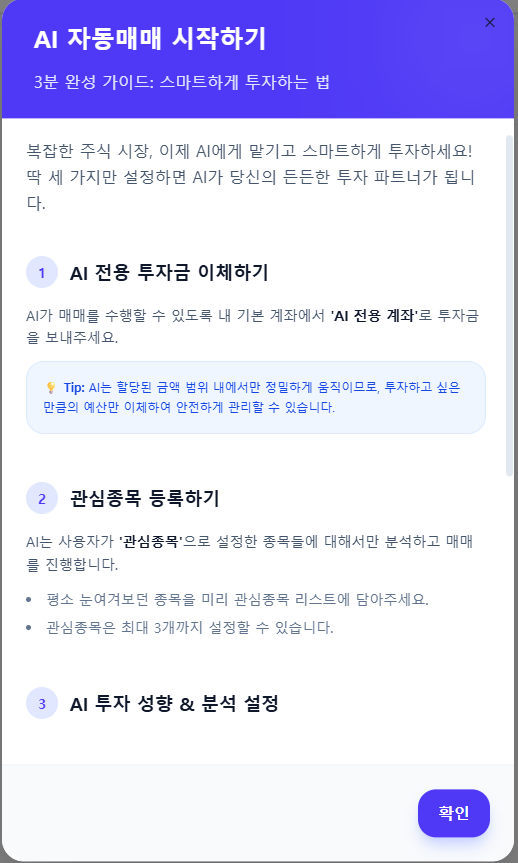

# SSAFY-Stock 화면 포트폴리오

[README](../README.md) · [기술 기여](engineering.md) · [개인 웹사이트](https://sukwoo-portfolio.vercel.app/)

## 시세와 모의 주문

팀 서비스의 화면입니다. 개인 기여는 README의 담당 영역과 기술 기여 문서에서 확인할 수 있습니다.

## 관심종목에서 모의 AI 매매로

AI 계좌·관심종목·투자성향으로 이어지는 팀 서비스의 안내 화면입니다.
저는 관심종목 등록·조회·삭제와 검증을 구현했으며, AI 매매 판단·자동 주문은 다른 팀원의 구현입니다.
